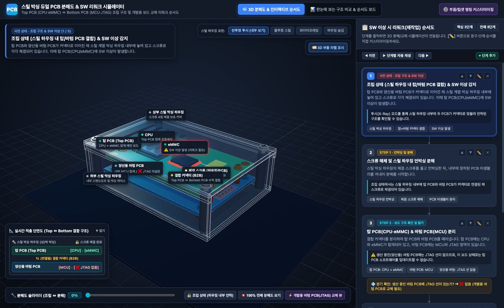
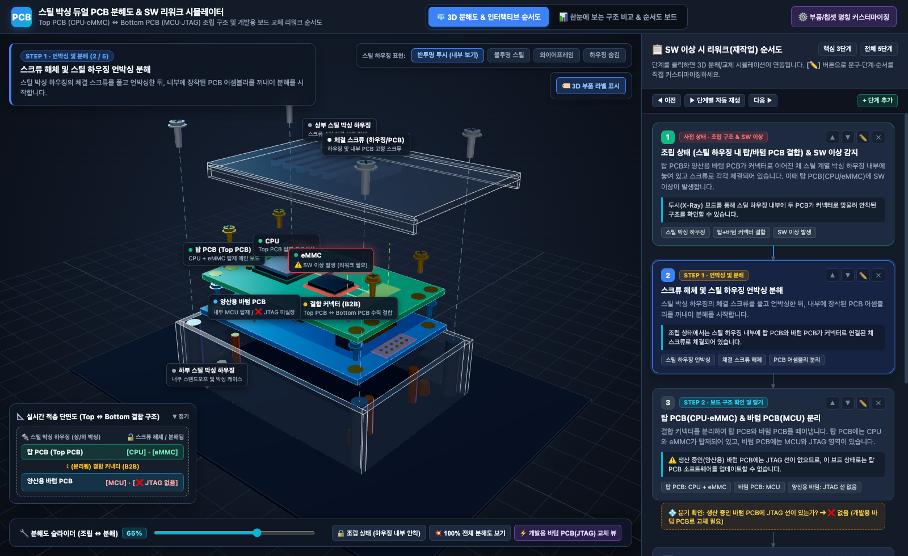
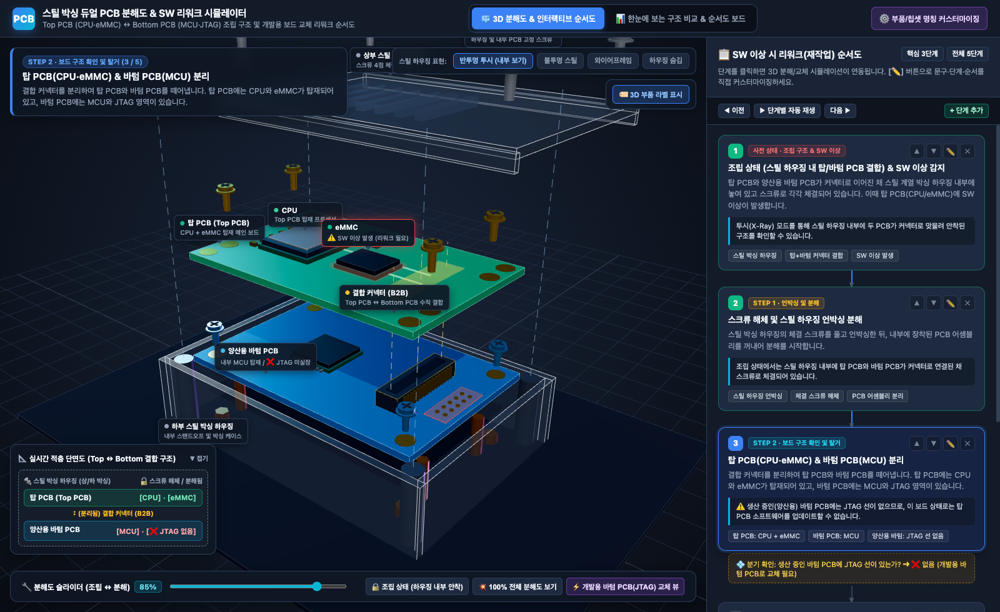
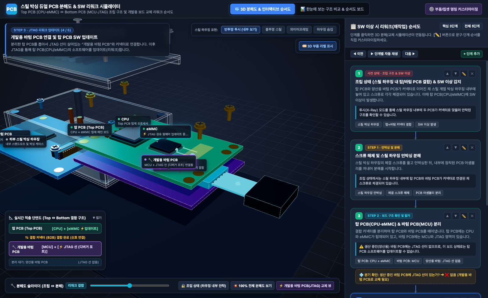
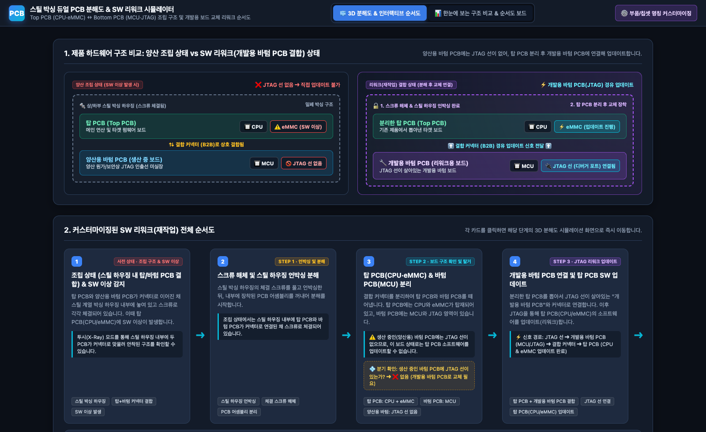

# 스틸 박싱 듀얼 PCB 분해도 & SW 리워크(재작업) 시뮬레이터

스틸 계열 박싱 하우징 내부에 장착된 **Top PCB (CPU + eMMC)**와 **Bottom PCB (MCU + 결합 커넥터)**의 조립 구조·분해도 및 소프트웨어 이상 발생 시 **개발용 Bottom PCB (JTAG 탑재)**로 교체하여 업데이트하는 리워크(Rework) 순서도를 시각화·커스터마이징하는 3D 웹 시뮬레이터입니다.

---

## 1. 제품 하드웨어 구조 및 리워크 배경

* **제품 조립 구조**:
  * **Top PCB (탑 PCB)**: 메인 연산을 담당하는 **CPU**와 타겟 소프트웨어/펌웨어가 저장되는 **eMMC**가 탑재되어 있습니다.
  * **Bottom PCB (바텀 PCB)**: 서브 컨트롤러인 **MCU**가 탑재되어 있으며, 조립 시 **보드 간 결합 커넥터(B2B Connector)**를 통해 Top PCB와 수직으로 연결됩니다.
  * **스틸 박싱 하우징 & 스크류**: 연결된 Top PCB와 Bottom PCB는 상/하부 **스틸 계열 박싱 하우징(Steel Housing)** 내부에 안착되며, 각각 체결 스크류로 고정됩니다.
* **소프트웨어 리워크(재작업) 필요 배경**:
  * 양산(생산 중) 제품에 장착된 **양산용 Bottom PCB**에는 원가/보안상 **JTAG 인출선이 실장되어 있지 않아**, 조립된 상태 그대로는 외부에서 Top PCB(CPU/eMMC)를 직접 업데이트할 수 없습니다.
  * 따라서 SW 이상 발생 시 **스크류 해체 및 언박싱 ➔ Top PCB 분리 ➔ JTAG 선이 살아있는 '개발용 Bottom PCB'와 결합 ➔ JTAG을 통한 Top PCB 업데이트** 순서로 리워크를 진행합니다.

---

## 2. 단계별 시뮬레이션 및 분해도 캡처 갤러리

이미지를 클릭하면 원본 해상도로 확인할 수 있습니다.

### 사전 상태 · 스틸 하우징 내부 조립 구조 (반투명 투시 뷰)

상/하부 스틸 박싱 하우징 내부에 Top PCB와 양산용 Bottom PCB가 커넥터로 연결된 채 스크류로 체결되어 있는 상태를 보여줍니다.

[](preview/01_assembled_xray.png)

---

### Step 1 · 스크류 해체 및 스틸 하우징 언박싱 분해

스틸 박싱 하우징의 체결 스크류를 풀고 상부 스틸 커버를 언박싱한 뒤, 내부에 장착된 PCB 어셈블리를 꺼내어 분해를 시작합니다.

[](preview/02_step1_unbox.png)

---

### Step 2 · 탑 PCB (CPU·eMMC) & 양산용 바텀 PCB (MCU) 커넥터 분리

결합 커넥터(B2B)를 분리하여 Top PCB와 양산용 Bottom PCB를 떼어냅니다. Top PCB에는 CPU와 eMMC가 있고, 양산용 Bottom PCB에는 MCU만 있고 JTAG 선이 없는 상태(`❌ JTAG 미실장`)를 확인할 수 있습니다.

[](preview/03_step2_pcb_split.png)

---

### Step 3 · 개발용 바텀 PCB (JTAG 탑재) 연결 및 탑 PCB SW 업데이트

분리한 Top PCB를 뽑아서 JTAG 선이 살아있는 보라색 **개발용 Bottom PCB (MCU + JTAG 포트)**의 커넥터에 결합합니다. 이후 `JTAG 디버거 ➔ 개발용 Bottom PCB ➔ 결합 커넥터 ➔ Top PCB (CPU / eMMC)` 경로로 소프트웨어를 업데이트(리워크)합니다.

[](preview/04_step3_dev_rework.png)

---

### 한눈에 보는 하드웨어 구조 비교 & 커스터마이징 순서도 보드

상단 `📊 한눈에 보는 구조 비교 & 순서도 보드` 탭에서 **양산 조립 상태 vs 리워크 결합 상태의 적층 다이어그램 비교**와 **전체 리워크 순서도**를 한 화면으로 확인할 수 있습니다.

[](preview/05_diagram_board.png)

---

## 3. 실행 및 커스터마이징 방법

별도의 빌드 과정이나 외부 네트워크 연결 없이 로컬 HTTP 서버로 바로 실행할 수 있습니다 (`vendor/` 내 Three.js 모듈 내장):

```sh
python3 -m http.server 8080
```

브라우저에서 `http://localhost:8080` 접속 후:
* **3D 뷰어 조작**: 마우스 드래그(회전), 휠(확대/축소), 우클릭 드래그(이동), 하단 **분해도 슬라이더(`0% ~ 100%`)** 조절
* **스틸 하우징 표현 전환**: 우측 상단에서 `반투명 투시`, `불투명 스틸`, `와이어프레임`, `하우징 숨김` 즉시 전환
* **순서도 커스터마이징**: 우측 패널에서 `핵심 3단계` / `전체 5단계` 프리셋 전환, 각 단계의 **`✏️` 편집 버튼**으로 제목·설명·노트·분기 조건·3D 동작 연동 수정, **`+ 단계 추가`** 및 **`▲`/`▼` 순서 변경**
* **부품/칩셋 명칭 커스터마이징**: 상단 `⚙️ 부품/칩셋 명칭 커스터마이징` 버튼으로 하우징, 스크류, PCB, CPU, eMMC, MCU, JTAG 등의 명칭을 실시간 변경
