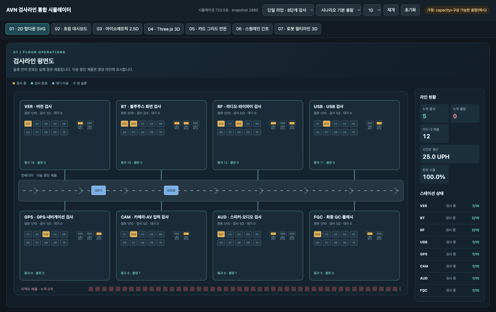
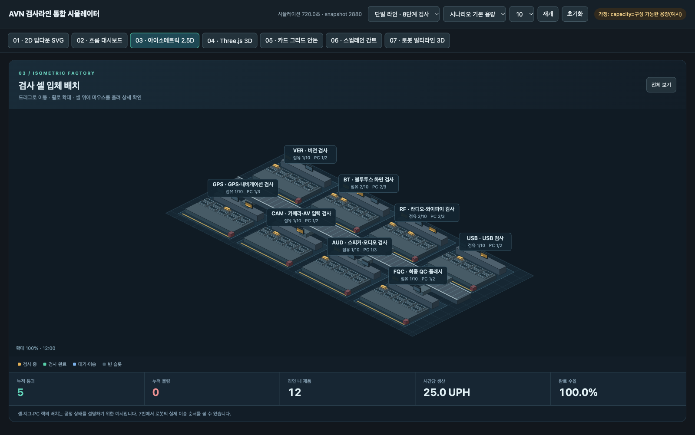
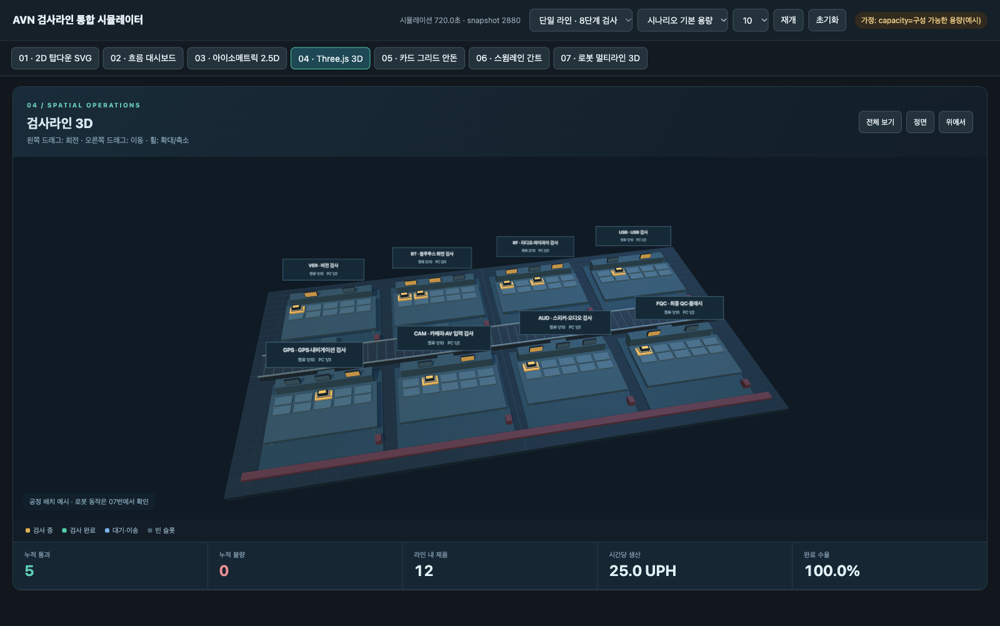
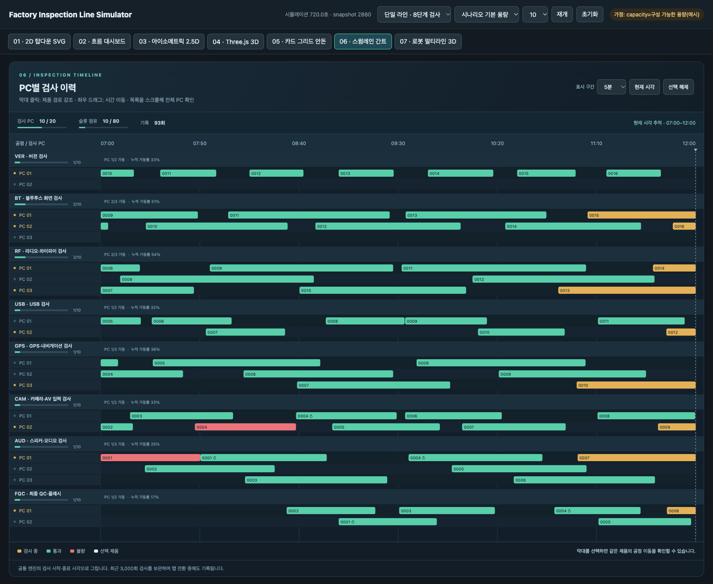
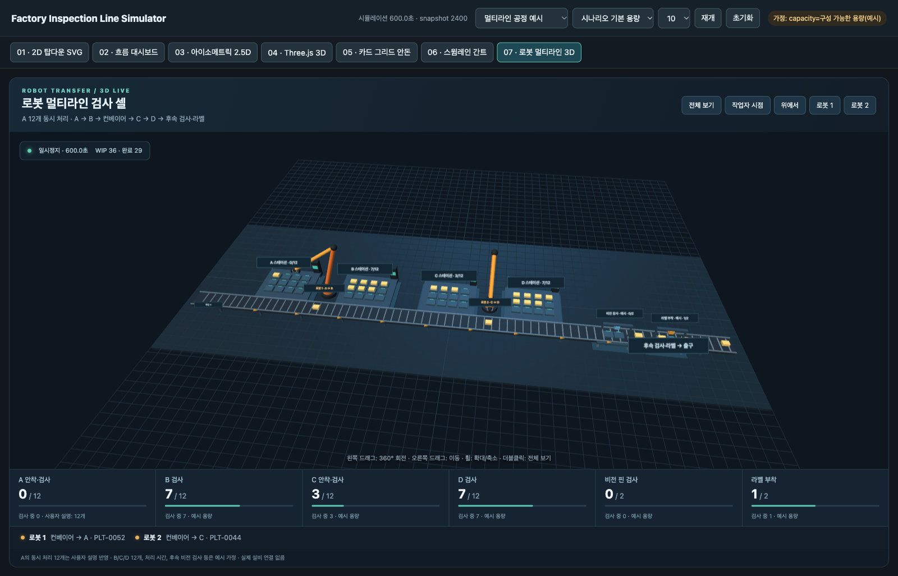

# AVN 공장 검사라인 시각화

원본 6개 시각 샘플과 하나의 공통 엔진을 사용하는 통합 시뮬레이터를 함께 보관합니다.

- **통합 시뮬레이터:** [실행 안내](03_unified_complete/README.md) · [index.html](03_unified_complete/index.html)
- **기존 원본 샘플 6종:** [원본 샘플 폴더](01_original_samples/) · [원본 데이터](01_original_samples/data/line.json)
- **완성본 소스·테스트·미리보기:** [03_unified_complete](03_unified_complete/)

통합 대시보드는 single_line의 AVN 8단계 검사와 multi_line_example의 로봇 2대, A/B/C/D, 비전, 라벨 흐름을 지원합니다. 시뮬레이션과 설비 값은 예시이며 실제 양산 설비나 PLC/MES에 연결되지 않습니다.

GitHub는 HTML을 실행하지 않습니다. 저장소를 내려받은 다음 03_unified_complete/index.html을 브라우저에서 열면 오프라인으로 확인할 수 있습니다.

## 화면 미리보기

| 01 · 2D 평면도 | 03 · 아이소메트릭 | 04 · Three.js |
|---|---|---|
|  |  |  |

| 06 · PC 검사 간트 | 07 · 로봇 멀티라인 3D |
|---|---|
|  |  |

## 검증

통합 폴더에서 node tests/invariants.node.js로 결정적 엔진·점유 불변식을 확인하고, sh qa/headless_qa.sh로 7개 화면과 공통 조작을 검사할 수 있습니다.
