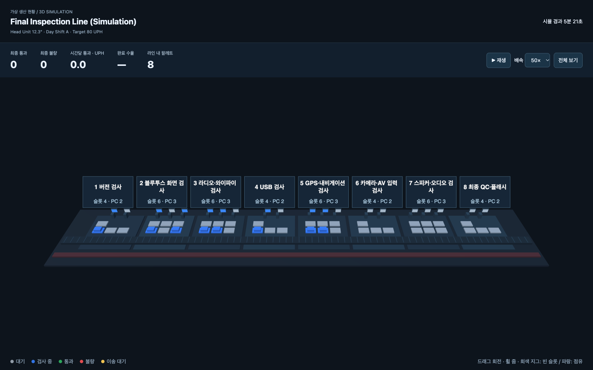
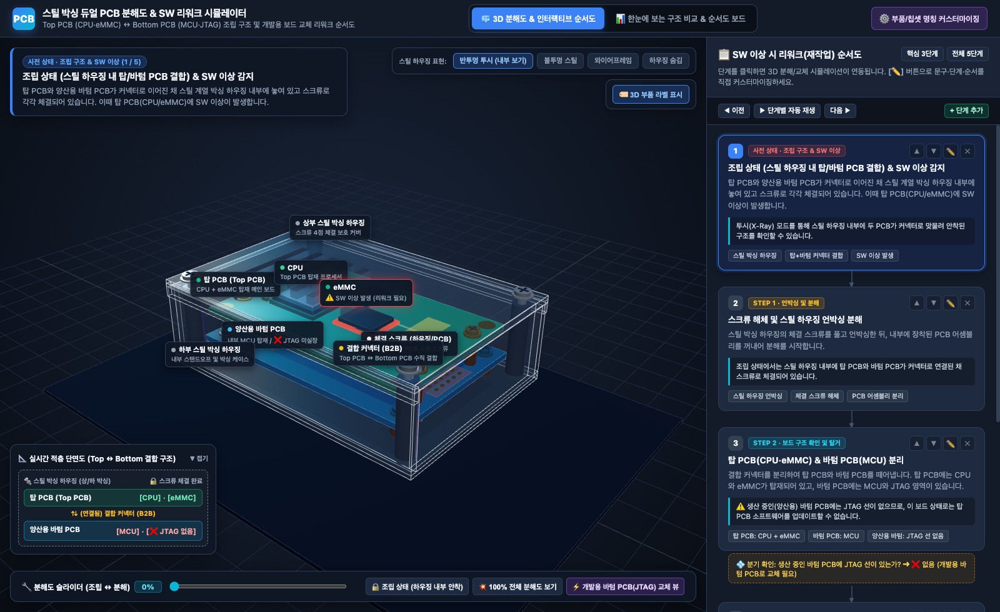
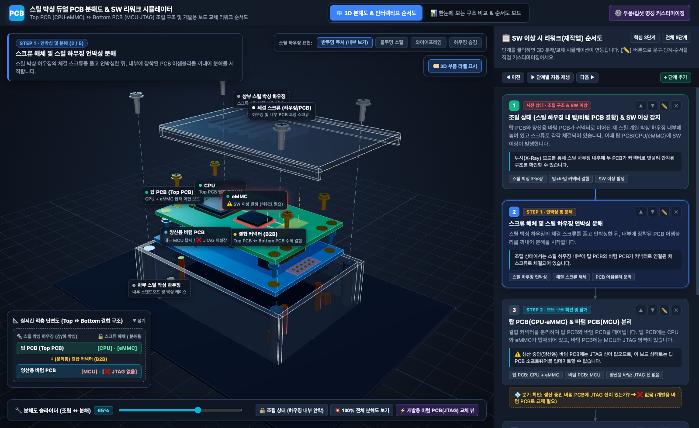
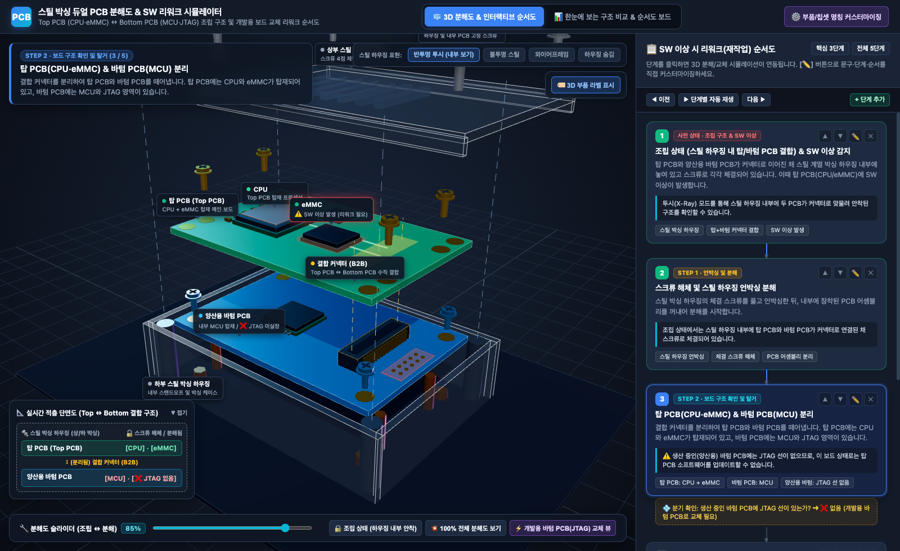
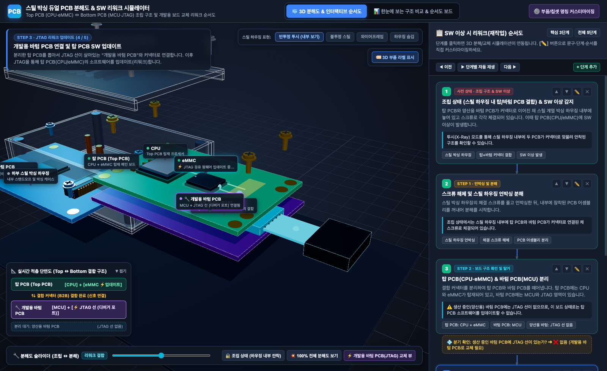
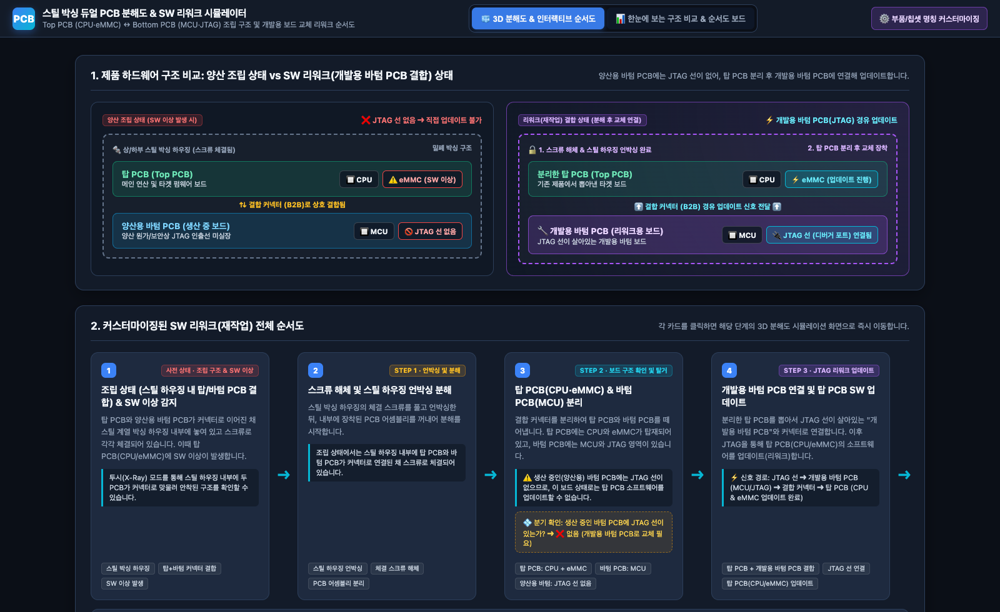

# Factory Inspection Line Simulator

This repository contains six original visualization samples alongside an integrated simulator with seven views powered by one engine.

## Run the simulator

Download or clone the repository, then open `03_unified_complete/index.html` in a browser. The simulator runs offline using the bundled assets. [Setup and controls](03_unified_complete/README.md)

- **Single line** shows the original eight-stage inspection sequence.
- **Robot transfer line** adds two robot arms, stations A through D, a vision check, and labeling.

The scenarios use example data and simulated equipment. The repository also includes the original sample collection and its line data. [Original samples](01_original_samples/) · [Original line data](01_original_samples/data/line.json)

## 3D views

Click any screenshot to open the full-size image.

### Original standalone Three.js

The original 3D sample arranges all eight inspection stations along one straight conveyor. Pallets move between fixtures, and failed units leave on a separate reject lane. Drag to rotate the camera and scroll to zoom. [Original 3D sample](01_original_samples/04_threejs_3d/index.html)

### 04 · Integrated Three.js

The integrated 3D view draws station occupancy and product movement from the same simulation as the other dashboard tabs. The camera stays in place as the simulation advances.

### 07 · Robot transfer line

Two robot arms move products between the conveyor and stations A through D. The view follows each transfer and includes camera presets for the full line and individual robot cells.

## Other dashboard views

### 01 · 2D floor plan

### 03 · Isometric layout

### 06 · Inspection timeline

## Verification

From `03_unified_complete/`, run `node tests/invariants.node.js` to check the simulation rules. Run `sh qa/headless_qa.sh` on macOS with Google Chrome to check the seven views and shared controls.

---

## Dual PCB Steel Housing Disassembly & SW Rework Simulator (`04_pcb_rework_simulation`)

Interactive 3D disassembly and software rework flowchart simulator for a dual-PCB product housed in a steel enclosure. [Detailed Korean guide & documentation](04_pcb_rework_simulation/README.md) · [Simulator entry](04_pcb_rework_simulation/index.html)

- **Assembled Structure**: **Top PCB** (`CPU` + `eMMC`) and **Bottom PCB** (`MCU`) are mated via a board-to-board (B2B) connector inside a steel boxing enclosure and fastened with screws.
- **Rework Workflow**:
  1. Unfasten screws, unbox the steel housing, and extract the internal PCB assembly.
  2. Separate the **Top PCB** (`CPU` + `eMMC`) and **Production Bottom PCB** (`MCU`, no JTAG lines).
  3. Connect the detached **Top PCB** to a **Development Bottom PCB** (equipped with `MCU` + `JTAG` lines) to re-flash/update the Top PCB firmware.

### Assembled Inside Steel Housing (X-Ray View)

### Step 1 · Unfasten Screws & Unbox Steel Housing

### Step 2 · Separate Top PCB (CPU·eMMC) & Production Bottom PCB (MCU)

### Step 3 · Mate Top PCB with Development Bottom PCB (JTAG) & Update SW

### Architecture Comparison & Customizable Rework Flowchart Board

